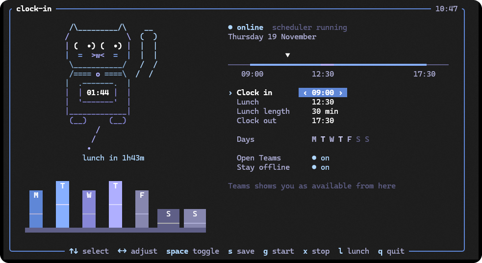

<div align="center">

# clock-in

Choose when Microsoft Teams shows you online, at lunch, and offline.



</div>

## What it does

The Windows Teams client sets your status from how recently you touched the keyboard or mouse. clock-in sets it from a schedule instead. During work hours you stay Available. At lunch it lets Teams go Away. At clock-out it closes Teams so you appear Offline and can switch off. To do this, clock-in sends an unused key (F15) when you've been idle for a minute, and closes `ms-teams.exe` after hours.

## Install

Requires Windows 10 or 11 and the new Teams client.

<details open>
<summary><b>Install script</b> (recommended)</summary>

In PowerShell:

```powershell
irm https://raw.githubusercontent.com/churnware/clock-in/main/install.ps1 | iex
```

This downloads the latest release to `%LOCALAPPDATA%\clock-in\bin`, checks its SHA-256, and adds that folder to your PATH. Run it again to update.

</details>

<details>
<summary><b>Build from source</b></summary>

Requires [Rust](https://rustup.rs).

```sh
cargo install --git https://github.com/churnware/clock-in
```

Or clone the repo, run `cargo build --release`, and put `target/release/clock-in.exe` somewhere on your PATH.

</details>

## Usage

```sh
clock-in                  # open the dashboard
clock-in start            # run the scheduler in the background
clock-in stop
clock-in status
clock-in set --in 09:00 --out 17:30 --lunch 12:30 --lunch-mins 30 --days mon-fri
clock-in lunch now        # take lunch early (or: clock-in lunch end)
```

In the dashboard, use `↑↓` to pick a field and `←→` to change it (hold `Shift` for an hour at a time). `space` or `1`–`7` toggles days, `s` saves, `g` starts the scheduler, `x` stops it, `l` starts lunch, and `q` quits. The scheduler keeps running after you close the dashboard. Run `clock-in start` again after you restart your PC.

## Configuration

Settings live in `%APPDATA%\clock-in\config.toml`, and the log is in `%LOCALAPPDATA%\clock-in\clock-in.log`. Set `CLOCK_IN_HOME` to keep everything in one folder instead.

| Option            | Default | Meaning                                                |
| ----------------- | ------- | ------------------------------------------------------ |
| `relaunch_teams`  | `true`  | Open Teams when the work day starts.                   |
| `enforce_offline` | `true`  | Close Teams again if it opens after hours or on days off. |